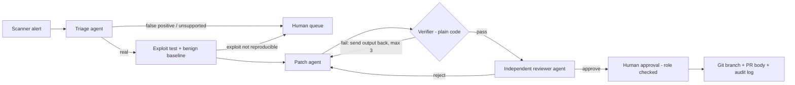

# PatchSentinel

**Multi-agent security remediation where a fix is accepted only when it is proven, reviewed and human-approved.**
AgentOps 2026 · CGI business domain: **IT Infrastructure** (investigate an incident, execute a verified, human-approved recovery, applied to security alerts in an IT estate).

## The business process it automates

| Stage | What happens | Where |
|---|---|---|
| 1. Data ingestion | Scanner findings (Bandit live, or any scanner via SARIF) plus the repo and its own tests | `scanners.py` |
| 2. Intelligent decision-making | Triage (real / false positive / escalate), exploit reproduction, patch, independent review | `agents.py`, `graph.py` |
| 3. Action execution | Deterministic verifier gates the fix; a human approves; approved fix lands on its own git branch with a PR body | `verifier.py`, `report.py` |
| 4. Outcome reporting | Per-alert evidence, ROI estimate, tamper-evident audit log | `report.py`, `audit.py` |



## What makes a fix "proven"
The verifier (no language model) accepts a patch only if **all** hold:
1. A generated exploit test **fails on the original code** (the flaw is real) and **passes on the patched code**.
2. A **behaviour baseline** recorded from the original code (inputs mined from the project's own tests) is unchanged after the patch.
3. The project's existing test suite passes.
4. The scanner rule no longer fires in that function.
5. **Integrity:** the patch does not embed exploit-test strings (test gaming) and is not oversized.

Then an independent reviewer agent (separate context) must approve, then a human with an allowed role must approve. Nothing is auto-merged.

## Quick start (Linux, macOS, WSL or GitHub Codespaces; Python 3.10+)
```bash
git clone <this repo> && cd patchsentinel
python -m venv .venv && source .venv/bin/activate
pip install -r requirements.txt

python -m patchsentinel benchmark                 # 10 seeded cases, no API key needed
python -m patchsentinel run demo_target --approve interactive --approver "Your Name" --role reviewer
python -m pytest                                  # tests for PatchSentinel itself
```
Each run writes `out/run_*/report.md` (evidence, diffs, ROI), `results.json`, `audit.jsonl`, and per alert `fix.patch`, `PR_BODY.md`, `exploit_test.py`.
Verify the audit log: `python -m patchsentinel audit-verify out/run_*/audit.jsonl`.

### Use a real model
```bash
pip install anthropic && export ANTHROPIC_API_KEY=...   # optional: PATCHSENTINEL_MODEL=<model id>
python -m patchsentinel run demo_target --provider anthropic --only get_user
# any OpenAI-compatible endpoint:
export OPENAI_API_KEY=... OPENAI_BASE_URL=https://api.openai.com/v1 PATCHSENTINEL_MODEL=<model id>
python -m patchsentinel run demo_target --provider openai
```
With `--provider offline` (default) triage, patching and review use deterministic rules for three bug classes. This keeps the demo and benchmark reproducible without credentials; it is not a language model.

### Your own repo or scanner
`python -m patchsentinel run /path/to/repo [--sarif results.sarif] [--policy policy.json] [--apply]`. Any scanner that emits SARIF can feed it. `--apply` commits approved fixes to separate branches using a git worktree, leaving your checkout untouched.

## Measured results (seeded benchmark, offline provider)
10 seeded alerts in `demo_target/`: 6 real flaws (2 SQL injection, 2 command injection, 2 path traversal), 2 false positives, 2 simulated adversarial patches (one breaks behaviour, one special-cases the exploit string).

| Outcome | Result |
|---|---|
| Behaved as expected | **10 / 10** (`python -m patchsentinel benchmark`) |
| Real flaws verified | 6 / 6 (one path-traversal fix was first rejected as a bypassable blacklist, then fixed on retry) |
| False positives rejected before any patch | 2 / 2 |
| Adversarial patches blocked after 3 attempts | 2 / 2 (behaviour change caught by baseline and existing tests; exploit-string special-casing caught by the integrity check and the scanner) |
| Wall time, 10 alerts | about 1 minute on a laptop-class machine (no model latency in offline mode) |

Building this benchmark exposed two weaknesses in the first version of our own verifier (a case-sensitive leak check that missed an upper-casing function, and an integrity check that compared against benign expected outputs). Both were fixed and are covered by the benchmark.

## Responsible AI and governance
| Control | Implementation |
|---|---|
| Human approval | Draft-only; `--approve` needs an allowed role (`policy.json`); decisions are logged |
| Role-based access | `approver_roles` in policy; other roles are refused and the refusal is logged |
| Audit trail | Append-only JSONL, hash-chained; `audit-verify` detects edited or reordered entries |
| Explainability | Every verdict has a reason; every check shows PASS/FAIL with detail; PR body lists the evidence |
| Security | Subprocess with scrubbed environment (no API keys passed), timeouts, Python-level network block; only operates on repos you supply |
| Model output never trusted | Malformed model replies escalate to a human; the verifier decides, not the model |
| Privacy | Demo data is synthetic; no source code leaves the machine in offline mode |

## Reusability
Scanner-agnostic (Bandit, SARIF), model-agnostic (offline, Anthropic, any OpenAI-compatible API), policy-driven (`policy.json`), and extensible: a new bug class is one rule mapping plus one exploit-test template in `exploit.py`. It is designed as a repeatable pattern for delivery teams: ingest findings, prove fixes, route to a human, report.

## Business value
`report.md` reports verified fixes, false positives screened, escalations, machine minutes and LLM tokens. The analyst-time figure is an **estimate** computed from `manual_fix_minutes` and `manual_triage_minutes` in `policy.json`. The defaults (60 and 15) are placeholders, not measurements; replace them with your own baseline.
Context for the problem: Veracode's 2026 State of Software Security reports that 82% of organisations carry security debt older than a year (https://www.cyentia.com/publication/2026-state-of-software-security/).

## Limitations (stated plainly)
- Python only; function-level entry points; three bug classes (SQL injection, path traversal, command injection). Anything else is escalated, never guessed.
- Exploit tests are template-based and check specific payload families, so passing them is strong evidence but not a proof of security. The human approval step exists for this reason.
- Isolation is best-effort (temporary copy, scrubbed environment, timeouts, Python-level network block). It is **not** a hardened sandbox: run it only on code you own or on the intentionally vulnerable demo target.
- Offline mode is rule-based. LLM mode is implemented and tested against a stub model in `tests/`; results with a live model depend on your provider and model.
- GitHub's own autofix and other tools exist. PatchSentinel's contribution is the proof gate, the anti-gaming checks and the audit trail, and it complements those tools.

## Layout
`patchsentinel/` engine · `demo_target/` intentionally vulnerable synthetic app and its tests · `tests/` tests for the engine · `policy.json` governance and ROI assumptions.
